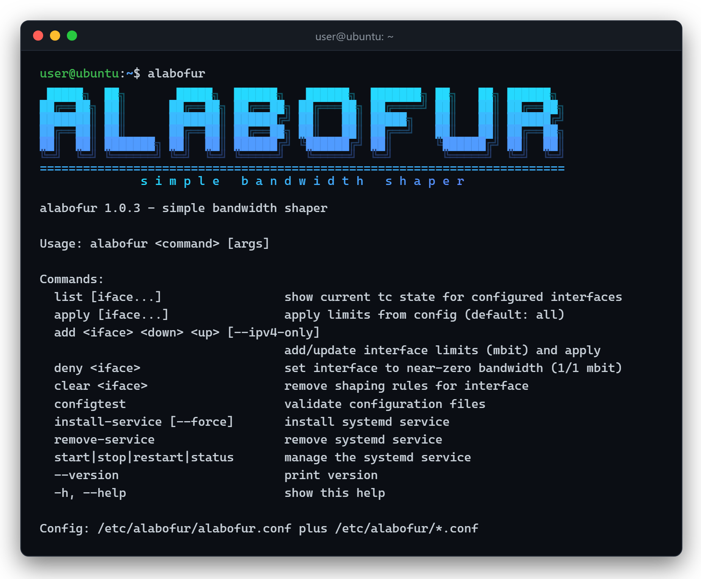

# alabofur

Simple ufw-like CLI to cap upload/download speeds. Inspired by wondershaper;
ships with a systemd service so limits persist across reboot. Needs a Linux with
`systemd`; the required `iproute2`/`kmod` packages are auto-installed when
missing. Language: English.



## Supported distributions

- Ubuntu 20.04, 22.04, 24.04, 26.04 (deb)
- Debian 8+ (deb)
- Fedora 36+ (rpm)
- RHEL/CentOS/Alma/Rocky 8+ (rpm)
- openSUSE Leap/Tumbleweed (rpm)
- Arch/Manjaro (pacman)

## Installation

### Debian / Ubuntu (apt)

```bash
curl -fsSL https://tuncaybahadir.github.io/alabofur/alabofur.asc | sudo gpg --dearmor -o /usr/share/keyrings/alabofur.gpg
echo "deb [signed-by=/usr/share/keyrings/alabofur.gpg] https://tuncaybahadir.github.io/alabofur/deb ./" | sudo tee /etc/apt/sources.list.d/alabofur.list
sudo apt update && sudo apt install alabofur
```

### Ubuntu (PPA)

Ubuntu users can alternatively install from the Launchpad PPA (built for Ubuntu
20.04, 22.04, 24.04 and 26.04):

```bash
sudo add-apt-repository ppa:tuncaybahadirr/alabofur
sudo apt update
sudo apt install alabofur
```

### Fedora / RHEL / CentOS (dnf/yum)

```bash
sudo curl -fsSL https://tuncaybahadir.github.io/alabofur/rpm/alabofur.repo -o /etc/yum.repos.d/alabofur.repo
sudo rpm --import https://tuncaybahadir.github.io/alabofur/alabofur.asc
sudo dnf install alabofur
```

### Arch / Manjaro

Build a pacman-managed package from the bundled `PKGBUILD` (no AUR needed):

```bash
git clone https://github.com/tuncaybahadir/alabofur.git
cd alabofur/packaging/aur
makepkg -si
```

`pacman -R alabofur` removes it cleanly. You can also install from source on any
distribution (see below).

### Direct download

Grab the `.deb` / `.rpm` from
[GitHub Releases](https://github.com/tuncaybahadir/alabofur/releases) and install
with `dpkg -i` / `rpm -i`.

### From source

```bash
git clone https://github.com/tuncaybahadir/alabofur.git
cd alabofur
sudo make install            # installs to /usr (PREFIX=/usr by default)
sudo make uninstall          # remove
```

To update later, pull the latest changes and reinstall:

```bash
git pull
sudo make install
```

## Persistence on boot (systemd)

```bash
sudo alabofur install-service     # writes /etc/systemd/system/alabofur.service
sudo systemctl start alabofur     # apply now (install-service already enables it)
```

On boot the service runs `alabofur service-run`, which validates the config and
re-applies every configured interface. `remove-service` disables and removes it.

## Usage

`alabofur` is a command-line tool (no GUI), driven by short verb-style
subcommands just like `ufw`:

```
alabofur 1.0.3 - simple bandwidth shaper

Usage: alabofur <command> [args]

Commands:
  list [iface...]                 show current tc state for configured interfaces
  top [iface...]                  live traffic per interface and process (q to quit)
  apply [iface...]                apply limits from config (default: all)
  add <iface> <down> <up> [--ipv4-only]
                                  add/update interface limits (mbit) and apply
  deny <iface>                    set interface to near-zero bandwidth (1/1 mbit)
  clear <iface>                   remove shaping rules for interface
  configtest                      validate configuration files
  install-service [--force]       install systemd service
  remove-service                  remove systemd service
  start|stop|restart|status       manage the systemd service
  --version                       print version
  -h, --help                      show this help

Config: /etc/alabofur/alabofur.conf plus /etc/alabofur/*.conf
```

### Behaviour

- **`add` both saves and applies:** it writes the interface config and applies
  the limit immediately. Install the systemd service for the limits to be
  re-applied from config on reboot.
- **Root enforcement:** commands that change limits abort with
  `This command must be run as root.` when not run as root.
- **Exit codes:** `0` on success, `1`/`2` on error or bad arguments — safe to
  call from scripts.
- **Input validation:** non-integer or missing limits, and invalid interface
  names (1-15 characters from `A-Z a-z 0-9 _ . -`, not starting with `-`), are
  rejected before any change is made.
- **Live interface rates on the help screen:** on a terminal, `alabofur` and
  `alabofur --help` sample every interface for one second and show its current
  download/upload rate and configured limit under the logo.
- **Root-only config:** config files are written with `umask 077` (directory
  `0700`, files `0600`), so `list` and `configtest` need root to read them.

### Man page

Run `man alabofur` for the manual. It is installed automatically — the apt/dnf
package and `make install` both place it; no manual step needed.

## Configuration

Default file: `/etc/alabofur/alabofur.conf`. Additional per-interface files:
`/etc/alabofur/*.conf`. INI format — each section name is the interface:

```ini
[eth0]
download_mbit = 50
upload_mbit = 10
ipv6 = true

[wlan0]
download_mbit = 20
upload_mbit = 5
```

`download_mbit` and `upload_mbit` are required integers (Mbit). `ipv6` is an
optional boolean (default `true`) accepting `true/false/yes/no/on/off/1/0`.

## Examples

Add limits (download/upload in Mbit); `add` saves config **and** applies it:

```console
$ sudo alabofur add eth0 50 10
saved config eth0 at /etc/alabofur
applied eth0: down=50mbit up=10mbit
```

Show configured limits plus the live `tc` state:

```console
$ sudo alabofur list eth0
[eth0] configured: down=50mbit up=10mbit ipv6=true
qdisc htb 1: root refcnt 2 r2q 10 default 0x30 ...
qdisc sfq 30: parent 1:30 ...
qdisc ingress ffff: parent ffff:fff1 ...
```

Watch live traffic per interface and per process (refreshed every second, `q`
to quit). `USE` is the share of the configured limit in use, `DROPS` the
packets dropped by shaping; traffic that is not tied to a TCP socket (UDP,
packet headers) is shown as `(other)`:

```console
$ sudo alabofur top
IFACE    STATE            DOWN            UP  LIMIT         USE            DROPS
eth0     up        18.6 Mbit/s    373 kbit/s  20/5 mbit     ███████░  93%  0

PROCESS                  DOWN            UP  CONNS  TOP PEER
curl              17.9 Mbit/s      0 kbit/s      1  185.125.190.37:443
(other)            716 kbit/s    373 kbit/s      -  -
```

Throttle an interface to near-zero (1/1 Mbit):

```console
$ sudo alabofur deny wlan0
set wlan0 to minimal bandwidth (deny)
applied wlan0: down=1mbit up=1mbit
```

Remove shaping:

```console
$ sudo alabofur clear eth0
cleared shaping for eth0
```

Validate configuration (non-zero exit + a precise message on error):

```console
$ sudo alabofur configtest
config OK

$ sudo alabofur configtest
/etc/alabofur/bad.conf: section [eth0] must define download_mbit and upload_mbit
```

Disable IPv6 ingress filters for an interface:

```console
$ sudo alabofur add eth0 50 10 --ipv4-only
```

## Security

To report a vulnerability privately, see [SECURITY.md](SECURITY.md).

## Support

If you find alabofur useful, you can support its development:

<a href="https://www.buymeacoffee.com/tuncaybahadir"></a>

## Maintainer

Tuncay Bahadır — <tuncaybahadir@protonmail.com>
